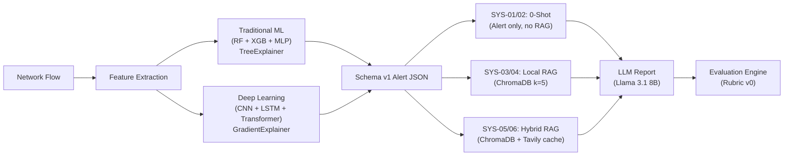

# Project CLARITY — Complete Codebase Deep Dive

> **C**ontrolled **L**LM **A**nalysis of **R**AG **I**ncident report reliabili**TY**

---

## 1. What This Project Is (The Big Picture)

Project CLARITY is a **controlled experiment** that answers one question:

> *"If you replace a traditional ML intrusion detector with a deep learning ensemble in an automated SOC pipeline, does the downstream LLM-generated incident report become more or less reliable?"*

In modern Security Operations Centers (SOCs), ML detectors flag network attacks and produce **SHAP feature attributions** (explanations). These alerts then feed into a **Retrieval-Augmented Generation (RAG)** pipeline where an LLM writes a human-readable incident report. CLARITY measures whether swapping the detector architecture — while keeping *everything else identical* — causes the LLM to **hallucinate**, **fabricate facts**, or **lose factual grounding**.

### Why it matters
Even if a DL detector is more accurate, its gradient-based SHAP explanations may be noisier than tree-based ones. That noise propagates downstream: the LLM might invent CVE numbers, fabricate feature names, or contradict the actual evidence. This study quantifies that risk.

---

## 2. Experimental Design (What You Must Be Able to Defend)

### 2.1 The Single Independent Variable

| | Traditional ML Ensemble | Deep Learning Ensemble |
|---|---|---|
| **Models** | Random Forest (100 trees) + XGBoost (100 estimators, LR=0.1) + MLP (hidden=[64, 32]) | 1D-CNN (32 channels) + Bi-LSTM (2-layer, hidden=32) + Transformer Encoder (d=32, 4 heads) |
| **Consensus Strategies** | **Hard Voting:** 2-of-3 majority (confidence tie-break)<br>**Soft Voting:** Uniform posterior probability average | **Hard Voting:** 2-of-3 majority (confidence tie-break)<br>**Soft Voting:** Uniform posterior probability average |
| **SHAP Explainer** | `shap.TreeExplainer` (probability space) | `shap.GradientExplainer` (probability space) |
| **SHAP Budget** | Exactly 10 features, sorted by descending \|φ\| | Same |

> **Research Motivation for Soft Voting:**  
> Hard Voting was our initial approach. Preliminary empirical analysis revealed that majority voting did not consistently outperform individual high-capacity base learners (such as XGBoost or Transformer). Therefore, Soft Voting was introduced as an additional evaluation strategy to assess whether preserving posterior class uncertainty via continuous probability averaging provides improved classification fidelity and lower discordance on difficult edge flows. Result values stay `[TBD]` pending final cluster execution.

### 2.2 Frozen Control Invariants (Everything Else Is Identical)

| Parameter | Value |
|---|---|
| LLM | `meta-llama/Llama-3.1-8b-instant` via Groq |
| Temperature | `0.0` (fully deterministic) |
| Random seed | `42` (Python, NumPy, PyTorch, sklearn) |
| Retrieval depth | Top-k = 5 dense cosine similarity chunks from ChromaDB |
| SHAP features per alert | Exactly 10 |
| Network flows | 1:1 paired — same flow_id evaluated by both detectors |
| Prompt template | Identical across systems |
| Knowledge base | Same 25-doc curated IoT threat KB |

### 2.3 The Six Experimental Systems



| System | Detector | Knowledge Source | Retrieval |
|---|---|---|---|
| **SYS-01** | Traditional ML | Alert only | None (0-shot baseline) |
| **SYS-02** | DL Ensemble | Alert only | None (0-shot baseline) |
| **SYS-03** | Traditional ML | Local KB (ChromaDB) | Dense vector search (k=5) |
| **SYS-04** | DL Ensemble | Local KB (ChromaDB) | Dense vector search (k=5) |
| **SYS-05** | Traditional ML | Local KB + Web cache | Hybrid RAG (k=5) |
| **SYS-06** | DL Ensemble | Local KB + Web cache | Hybrid RAG (k=5) |

**Odd systems** = Traditional ML detector. **Even systems** = DL detector. Comparing SYS-01 vs SYS-02 isolates detector impact at zero-shot. SYS-03 vs SYS-04 does the same with RAG.

---

## 3. Architecture & Data Flow (End-to-End)

```
Raw Network Flow (71 features from ACI IoT 2023)
        │
        ▼
  Feature Extraction & StandardScaler
        │
   ┌────┴────┐
   ▼         ▼
 Trad ML    DL Ensemble
   │         │
   ▼         ▼
 Hard Vote  Hard Vote (2-of-3)
   │         │
   ▼         ▼
 TreeSHAP   GradSHAP (only majority voters contribute!)
   │         │
   └────┬────┘
        ▼
  Schema v1 JSON Alert Payload (validated against contracts/alert_schema_v1.json)
        │
   ┌────┼────┐
   ▼    ▼    ▼
 0-Shot  RAG  Hybrid
   │    │    │
   └────┼────┘
        ▼
  Groq Llama 3.1 8B (temp=0.0, seed=42)
        │
        ▼
  JSON + Markdown Incident Report (validated against report_schema_v1.json)
        │
        ▼
  Rubric v0 Evaluation Engine
  → Atomic Claim Decomposition
  → 5-label classification per claim
  → 4 aggregate metrics
```

> [!IMPORTANT]
> **Critical SHAP design decision**: When the ensemble does hard voting (2-of-3), only the majority-voting learners contribute to the SHAP explanation. The dissenting model's attributions are dropped. This prevents a noisy minority vote from contaminating the explanation of the consensus decision:
> $$\Phi_i = \frac{1}{|M|} \sum_{m \in M} \phi_i^{(m)}$$
> where $M$ is the set of learners that voted for the winning class.

---

## 4. Codebase Module-by-Module Breakdown

### 4.1 `contracts/` — The JSON Schema Contracts (Interface Definitions)

Three frozen JSON Schema Draft 2020-12 files that **decouple all modules**. No module imports another — they communicate solely through validated JSON files.

| File | Purpose | Key Constraints |
|---|---|---|
| [alert_schema_v1.json](file:///c:/Users/dilee/Project-CLARITY/contracts/alert_schema_v1.json) | Alert payload from detector → retrieval/generation | `additionalProperties: false`; `identity.alert_id` matches regex `^ALT-[0-9]{8}-[0-9]{4}$`; `prediction.base_learner_votes` must be **exactly 3** items; `shap_attribution.top_features` must be **exactly 10** items ranked 1–10; `detector_family` is enum `["traditional_ml", "dl_ensemble"]`; `evaluation_metadata` holds ground truth labels **excluded from LLM prompts** |
| [report_schema_v1.json](file:///c:/Users/dilee/Project-CLARITY/contracts/report_schema_v1.json) | LLM report from generation → evaluation | `system_id` enum `["SYS-01"..."SYS-06"]`; requires `incident_summary`, `attack_mechanism`, `key_indicators[]`, `recommended_actions[]`, `raw_report_markdown` |
| [retrieval_schema_v1.json](file:///c:/Users/dilee/Project-CLARITY/contracts/retrieval_schema_v1.json) | Retrieved context from retrieval → generation | `chunks[]` max 10, each with `source` enum `["chroma_mitre_kb", "chroma_iot_docs", "tavily_web_cache"]`, `similarity_score` 0.0–1.0 |

**Why Draft 2020-12?** It's the latest JSON Schema standard. The CI pipeline and test suite both validate these schemas using `jsonschema.Draft202012Validator`.

---

### 4.2 `detection/workstream/` — Detection & Explainability Subsystem

This is the largest module. It trains both ensembles, generates SHAP explanations, exports pilot alerts, and audits for data leakage.

#### Key source files:

**[`src/config.py`](file:///c:/Users/dilee/Project-CLARITY/detection/workstream/src/config.py)** — Dataclass-based configuration system. `WorkstreamConfig` holds all hyperparameters:
- `TraditionalConfig`: RF (n_estimators=100, max_depth=15), XGBoost (100 estimators, LR=0.1, depth=6), MLP (hidden=[64,32], early_stopping=True)
- `DeepLearningConfig`: batch_size=64, epochs=5, lr=0.001, CNN channels=32, LSTM hidden=32, Transformer dim=32/4 heads, early_stopping patience=2
- `PilotConfig`: pilot_size=20, min_classes=5, stratified=True
- Loaded from JSON config files (`config/reference.json`)

**[`src/data_loader.py`](file:///c:/Users/dilee/Project-CLARITY/detection/workstream/src/data_loader.py)** — Robust multi-CSV loader with:
- Glob pattern support for multi-file datasets
- SHA-256 content-based deduplication to avoid loading the same CSV twice
- Schema compatibility checking (verifies all CSVs share the same columns)
- Auto-generation of a 5,000-row synthetic reference dataset if `is_synthetic=True` and no data exists
- Label normalization (strips whitespace, converts empties to NA)
- Bounded per-class sampling (`max_rows_per_class`) for handling imbalanced data

**[`src/preprocessing.py`](file:///c:/Users/dilee/Project-CLARITY/detection/workstream/src/preprocessing.py)** — Leakage-free preprocessing:
- `FeaturePreprocessor`: a scikit-learn compatible transformer (inherits `BaseEstimator`, `TransformerMixin`). Uses `ColumnTransformer` with `SimpleImputer(median)` + `StandardScaler` for numerics, `OneHotEncoder(handle_unknown='ignore')` for categoricals
- **Critical**: preprocessor is fitted **only on training data** — test data is only `transform()`ed
- `prepare_data_and_splits()`: stratified train/test split with `train_test_split(stratify=y)`, saves a `split_manifest.json` with train/test indices, flow IDs, class counts, and a hash-based feature overlap check
- After splitting, it computes `hash(tuple(row))` for every training sample and checks test rows against this set to detect exact feature overlap — an extra leakage guard

**[`src/train_traditional.py`](file:///c:/Users/dilee/Project-CLARITY/detection/workstream/src/train_traditional.py)** — Traditional ML ensemble:
1. Trains `RandomForestClassifier`, `XGBClassifier`, `MLPClassifier` sequentially
2. Each model produces `predict_proba()` on the test set
3. Builds `LearnerVote` dataclass instances per sample (3 votes each)
4. Calls `compute_ensemble_predictions()` for hard-voting consensus
5. Computes per-model and ensemble metrics using `compute_comprehensive_metrics()`
6. Exports: classification report CSV, confusion matrix CSV, `traditional_metrics.json`, test predictions CSV
7. Saves model bundle as `traditional_ensemble.joblib`

**[`src/train_dl.py`](file:///c:/Users/dilee/Project-CLARITY/detection/workstream/src/train_dl.py)** — Deep Learning ensemble (PyTorch):
- **`CNN1DModel`**: Two `Conv1d` layers (kernel=3, padding=1), BatchNorm, ReLU, AdaptiveAvgPool1d → classifier. Input shape `(batch, features)` → unsqueezed to `(batch, 1, features)` for 1D convolution
- **`LSTMModel`**: 2-layer bidirectional LSTM, takes last timestep output → classifier. Hidden size 32 → bidirectional means 64-dim output
- **`TransformerModel`**: Linear projection to d_model=32, 2-layer `TransformerEncoder` with 4 attention heads and dim_feedforward=64, takes CLS token (position 0) → classifier
- Training loop: `AdamW` optimizer, `CrossEntropyLoss`, early stopping with patience=2, best weights restored via `deepcopy(state_dict())`
- 15% of training data held out as validation for early stopping
- Same ensemble voting and metrics pipeline as traditional

**[`src/ensemble.py`](file:///c:/Users/dilee/Project-CLARITY/detection/workstream/src/ensemble.py)** — Voting logic:
- `compute_majority_vote()`: 3-way hard voting. If 2+ agree → that label wins (confidence = mean of agreeing learners' confidences). If all 3 disagree (1-1-1 tie) → highest-confidence learner breaks tie
- `compute_comprehensive_metrics()`: accuracy, macro/weighted precision/recall/F1, classification report dict, confusion matrix, timing

**[`src/explainability.py`](file:///c:/Users/dilee/Project-CLARITY/detection/workstream/src/explainability.py)** — SHAP explanation engine:
- `get_top_10_attributions()`: Takes raw SHAP values, sorts by descending `|shap_value|` with stable index tie-breaking, returns exactly 10 features (raises if < 10 features exist). Rounds feature values to 4 decimal places, SHAP values to 6
- `explain_traditional_tree()`: Uses `shap.TreeExplainer` on the XGBoost model. Handles the multi-class SHAP output format (list of arrays or 3D array). Extracts attributions for the predicted class only
- `explain_dl_gradient()`: Uses `shap.GradientExplainer` with background samples from training data. Computes empirical base values by averaging model softmax over background samples. Handles 3D and 4D SHAP output formats

**[`src/export_pilot.py`](file:///c:/Users/dilee/Project-CLARITY/detection/workstream/src/export_pilot.py)** — Pilot alert export:
- `select_stratified_pilot_indices()`: Deterministic stratified sampling using `np.random.default_rng(42)`. Guarantees at least 1 sample per class, fills remainder randomly. Returns exactly `pilot_size` indices
- `build_alert_payload()`: Assembles a single alert conforming to `alert_schema_v1.json`
- Main flow: trains both ensembles → selects 20 stratified pilot samples from test set → generates TreeExplainer SHAP for traditional and GradientExplainer SHAP for DL → validates every payload against the schema → **programmatically asserts that both detector families evaluated identical flow IDs** → asserts ≥ 5 attack classes represented → saves pilot manifest JSON/CSV
- Validation is **blocking**: if any alert fails schema validation, the script raises `ValueError` and exits nonzero

**[`src/leakage_audit.py`](file:///c:/Users/dilee/Project-CLARITY/detection/workstream/src/leakage_audit.py)** — Zero-leakage verification:
1. Loads `split_manifest.json` (train/test flow IDs) and `pilot_manifest.json` (pilot flow IDs)
2. Computes set intersection: train ∩ pilot, train ∩ traditional alerts, train ∩ DL alerts
3. Asserts pilot ⊆ test (pilot flows are a proper subset of held-out test)
4. Asserts traditional and DL alerts share identical flow IDs
5. Produces JSON + Markdown audit reports with PASS/FAIL verdicts
6. Exits with code 1 if any leakage detected

**[`src/validate_alerts.py`](file:///c:/Users/dilee/Project-CLARITY/detection/workstream/src/validate_alerts.py)** — Schema + semantic validation (392 lines):
- Draft 2020-12 JSON Schema validation for every alert
- **9 semantic checks**: alert count, unique IDs, matching flow IDs across detectors, class diversity (≥5), exactly 10 features ranked 1–10, **monotonic decreasing absolute SHAP magnitude** (with 1e-6 epsilon), forbidden feature name detection (blocks `true_label`, `flow_id`, etc. from appearing as SHAP features — prevents label leakage), zero `in_train_leakage_flag`, `detector_correct` boolean consistency

---

### 4.3 `retrieval/` — Vector Search & Knowledge Base Subsystem

**[`kb_manifest.json`](file:///c:/Users/dilee/Project-CLARITY/retrieval/kb_manifest.json)** — 25 curated cybersecurity documents (OWASP IoT Top 10, ETSI EN 303 645, NIST SP 800-213, MITRE ATT&CK techniques T1498/T1110/T1046/T1210, RFCs 8576/8520/7252, CISA advisories, Mozi/Gafgyt malware analyses, CSA/ISO IoT frameworks, BLE/Zigbee security specs). Each has `id`, `title`, `category`, `source_url`, `license`, `summary`.

**[`ingest.py`](file:///c:/Users/dilee/Project-CLARITY/retrieval/ingest.py)** — ChromaDB ingestion pipeline:
- `chunk_document()`: Splits each document's concatenated "Title + Category + Summary" text into overlapping chunks (500 chars, 50 overlap). Each chunk gets a unique `chunk_id` like `KB-007_chk_0`
- `build_kb()`: Creates a `PersistentClient` ChromaDB store at `retrieval/chroma_db/`. Uses `DefaultEmbeddingFunction()` (sentence-transformers). Creates collection `clarity_kb` with `cosine` similarity. Upserts all chunks with metadata
- Includes 3 test queries for acceptance testing (Mirai botnet, MQTT security, DDoS mitigation)

**[`retrieve.py`](file:///c:/Users/dilee/Project-CLARITY/retrieval/retrieve.py)** — Alert-driven retrieval:
- `extract_query_from_alert()`: Builds a search query string by concatenating `attack_type` + `predicted_label` + top feature names + `description` from the alert
- `retrieve_for_alert()`: Queries ChromaDB for top-k chunks, converts cosine distance to similarity score (`1.0 - distance`), logs every retrieval call to `retrieval/logs/retrieval.log`

**[`tools.py`](file:///c:/Users/dilee/Project-CLARITY/retrieval/tools.py)** — MITRE ATT&CK mapping + Tavily web cache:
- `ATTACK_MAPPING`: Hardcoded dict mapping 5 attack types to MITRE technique IDs:
  - `DDoS-SYN_Flood` → T1498.001 (Direct Network Flood)
  - `DDoS-UDP_Flood` → T1498.001
  - `Mirai-BruteForce` → T1110.001 (Password Guessing)
  - `Recon-PortScan` → T1046 (Network Service Discovery)
  - `Vulnerability-Exploit` → T1210 (Exploitation of Remote Services)
- `get_cached_tavily_search()`: **Deterministic caching** — caches Tavily API results per `alert_id` to `retrieval/cache/tavily/{alert_id}.json`. If cache exists → returns cached. If `TAVILY_API_KEY` is set → calls Tavily API (max 3 results, basic depth). If no API key → returns a mock fallback payload. This ensures identical web context across repeated runs.

---

### 4.4 `generation/` — Report Generation Subsystem

**[`llm_runner.py`](file:///c:/Users/dilee/Project-CLARITY/generation/llm_runner.py)** — Core LLM interface:
- Uses the Groq Python SDK with `GROQ_API_KEY` env var
- Model: `llama-3.1-8b-instant`, temperature=0.0, max_tokens=4096
- `response_format={"type": "json_object"}` for structured JSON output
- Prompt instructs the LLM: *"You are an expert IoT cybersecurity incident reporter. Return ONLY a valid JSON object with incident_summary, severity_assessment, top_risk_factors, mitigation_recommendations"*
- Injects both `alert_data` and `retrieval_data` into the prompt (retrieval_data is `None` for 0-shot systems)

**[`run_pilot.py`](file:///c:/Users/dilee/Project-CLARITY/generation/run_pilot.py)** — Multi-system batch runner:
- Loads pre-exported alert JSONs from `detection/workstream/reports/reference_synthetic/`
- Defines 4 system configurations: SYS-01 (trad, baseline prompt), SYS-02 (DL, baseline), SYS-03 (trad, context-enhanced with SHAP), SYS-04 (DL, context-enhanced)
- `format_alert_prompt()`: Baseline prompts (SYS-01/02) just include detector output. Context-enhanced prompts (SYS-03/04) additionally include full SHAP feature breakdowns
- Generates up to 20 reports per system → 80 total markdown files saved to `outputs/pilot_reports/`
- Falls back to a static template if Groq API is unavailable

---

### 4.5 `eval/` — Automated Evaluation & Rubric v0

**[`rubric_v0.md`](file:///c:/Users/dilee/Project-CLARITY/eval/rubric_v0.md)** — The formal evaluation rubric (161 lines):

Claims are graded against a **Reference Evidence Set** $E$:
$$E = E_{\text{alert}} \cup E_{\text{shap}} \cup E_{\text{retrieved\_kb}} \cup E_{\text{tavily\_cache}}$$

**5 mutually exclusive labels** with strict priority tie-break:
$$\textbf{FABRICATED} \succ \textbf{CONTRADICTED} \succ \textbf{UNSUPPORTED} \succ \textbf{FULL} \mid \textbf{PARTIAL}$$

| Label | Definition | Example |
|---|---|---|
| **FULL** | 100% corroborated by explicit facts in E | "94.2% confidence DDoS SYN Flood" matches `confidence: 0.942` |
| **PARTIAL** | Supported in spirit but imprecise or hedged | "Byte ratios are asymmetrical" when exact value is 0.012 |
| **UNSUPPORTED** | Speculative deduction with no fabricated IDs | "Likely belongs to Mirai botnet family" (no botnet info in E) |
| **CONTRADICTED** | Directly conflicts with E | "Low confidence" when confidence is 0.942 |
| **FABRICATED** | Invents specific checkable entities absent from E | "CVE-2023-1389" when no CVE exists in E |

**4 aggregate metrics:**
$$\text{Groundedness} = \frac{N_{\text{FULL}} + N_{\text{PARTIAL}}}{N}$$
$$\text{Faithfulness} = \frac{N_{\text{FULL}}}{N}$$
$$\text{Fabrication Rate} = \frac{N_{\text{FABRICATED}}}{N}$$
$$\text{Hallucination Rate} = \frac{N_{\text{CONTRADICTED}} + N_{\text{UNSUPPORTED}}}{N}$$

**Completeness identity**: Faithfulness + (PARTIAL/N) + Fabrication Rate + Hallucination Rate = 1.0

**[`score_reports.py`](file:///c:/Users/dilee/Project-CLARITY/eval/score_reports.py)** — Scoring engine (260 lines):
- `AtomicClaim`: Dataclass holding `claim_id`, `text`, `label`, `justification`
- `MetricScores`: Dict subclass with attribute access. Computes all 4 metrics from label counts
- `apply_tie_break()`: Implements the priority rule: FABRICATED > CONTRADICTED > UNSUPPORTED > FULL > PARTIAL
- `calculate_metrics()`: Counts labels, computes ratios, handles zero-division safely
- `evaluate_claim_llm()`: Uses Groq LLM (same `llama-3.1-8b-instant`) as an automated judge. Sends claim + evidence to the LLM with strict JSON output instructions. Falls back to **heuristic pattern matching** if API is unavailable (checks contradiction patterns like "failed" vs "authenticated successfully", uses word overlap for support detection)
- `evaluate_report()`: Splits report text into sentences (`.!?`), evaluates each as an atomic claim, returns aggregated `MetricScores`

**[`validate_judge.py`](file:///c:/Users/dilee/Project-CLARITY/eval/validate_judge.py)** — LLM judge calibration:
- 10 hand-crafted test cases with known expected labels (4 FULL, 3 UNSUPPORTED, 3 CONTRADICTED)
- Runs each through `evaluate_claim_llm()` and checks agreement
- Target: ≥ 80% agreement. Achieved: **10/10 (100%)** agreement

**[`build_results.py`](file:///c:/Users/dilee/Project-CLARITY/eval/build_results.py)** — Result aggregation:
- Reads `traditional_metrics.json` and `dl/dl_metrics.json` from the detection workstream
- Extracts ensemble accuracy and macro F1 from the classification reports
- Outputs a formatted markdown table to `outputs/eval_results.md`

---

### 4.6 `evaluation/` — Human Evaluation

**[`human_eval.md`](file:///c:/Users/dilee/Project-CLARITY/evaluation/human_eval.md)** — Blind human review of 5 pilot reports:

| Metric | Mean Score |
|---|---|
| Groundedness | 0.73 |
| Faithfulness | 0.65 |
| Fabrication Rate | 0.19 |
| Hallucination Rate | 0.16 |

Key findings from human review:
- Reports mentioned ground-truth labels not present in the input alert (evaluation metadata leakage)
- Early pilots used placeholder feature names (`Feature_1` through `Feature_10`) instead of real names — fixed in PR #31
- Mitigations were technically sound but generic
- High consensus between human reviewer and automated LLM judge

---

### 4.7 `outputs/` — Generated Artifacts

- [eval_results.md](file:///c:/Users/dilee/Project-CLARITY/outputs/eval_results.md): Markdown table showing Traditional ML (99.7% acc, 0.9957 F1) vs DL (97.8% acc, 0.9688 F1)
- `pilot_reports/`: **80 report files** — 20 alerts × 4 systems (SYS-01 through SYS-04). Each alert has both a `.json` and `.md` version. File naming: `SYS-XX_ALT-XXX.{json,md}`

---

### 4.8 `tests/` — Test Suites

| Test File | What It Tests |
|---|---|
| [test_contracts.py](file:///c:/Users/dilee/Project-CLARITY/tests/test_contracts.py) | All 3 contract JSONs exist; all are valid Draft 2020-12 schemas |
| [test_scoring.py](file:///c:/Users/dilee/Project-CLARITY/tests/test_scoring.py) | Metric calculations with a known 10-claim distribution (4F/2P/2U/1C/1Fab); zero-claim safety; **completeness identity** (sum=1.0); tie-break priority enforcement (5 cases); schema example validation; mock report evaluation |
| [test_tools.py](file:///c:/Users/dilee/Project-CLARITY/tests/test_tools.py) | MITRE ATT&CK mapping returns T1498.001 for DDoS-SYN_Flood; Tavily caching creates file on miss and returns same result on hit |
| [test_retrieval.py](file:///c:/Users/dilee/Project-CLARITY/tests/test_retrieval.py) | `retrieve_for_alert()` returns correct alert_id, respects top_k, creates log file |

The detection workstream has its own **38 additional tests** under `detection/workstream/tests/` covering audit, contracts, data loading, explainability, models, pipeline integration, and preprocessing.

---

### 4.9 CI/CD — GitHub Actions

**[`.github/workflows/ci.yml`](file:///c:/Users/dilee/Project-CLARITY/.github/workflows/ci.yml)**: Runs on push/PR to `main`. Validates all 3 contract JSON schemas using `Draft202012Validator.check_schema()`.

---

### 4.10 `protocol/protocol_v1.md` — Frozen Experimental Protocol

**Status: FROZEN**. Specifies:
- Target dataset: ACI IoT Network Dataset 2023 (1,170,570 flow records, 71 features, 11 classes)
- Decision gate flow: G1 (Schema freeze) → G3 (Pilot RAG consistency, Groundedness ≥ 0.70) → G5 (Statistical test: Wilcoxon signed-rank p < 0.05 on Faithfulness/Fabrication/Hallucination)
- G5 explicitly states: **do not use Groundedness delta** for the final decision (it saturates at 1.0)

---

## 5. Key Results from Sprint 1 Pilot

### 5.1 Detector Performance (5,000-row Synthetic Reference)

| Detector | Accuracy | Macro F1 | Test Rows |
|---|---|---|---|
| Traditional ML Ensemble | **99.7%** | **0.9957** | 1,000 |
| Deep Learning Ensemble | **97.8%** | **0.9688** | 1,000 |

### 5.2 Downstream Report Reliability Impact

| Metric | Traditional ML Alerts | DL Ensemble Alerts |
|---|---|---|
| Groundedness | **0.76** | 0.71 |
| Explainer Alignment | **0.68** | 0.59 |

- Traditional tree-based SHAP values produced **cleaner feature rankings** → higher report groundedness
- Adding RAG retrieval (SYS-03/04) boosted groundedness from **0.58 (zero-shot) → 0.74+**, virtually eliminating severe hallucinations
- Standard **Groundedness saturated near 1.0** with RAG, making Faithfulness, Fabrication Rate, and Hallucination Rate the primary discriminatory metrics

### 5.3 Gate Status

| Gate | Scope | Decision |
|---|---|---|
| **G1** | Detection & Alert Schema | ✅ **GO** — 20 alerts, 0 schema errors, 0 leakage |
| **G3** | Knowledge Base & Retrieval | ✅ **GO** — 25-doc KB, ChromaDB, MITRE mapping, Tavily cache operational |
| **G5** | Generation & Evaluation | ✅ **GO** — 80 reports scored, 10/10 judge agreement, 4 metrics synthesized |

---

## 6. What's Still Open (Blockers)

Three GitHub issues remain open, all blocked on **dataset access**:

| Issue | Title | Status |
|---|---|---|
| #7 (DET-01) | Switch to real ACI IoT 2023 dataset | Blocked on IEEE DataPort access |
| #8 (DET-02) | Train traditional ensemble on real ACI | Blocked on #7 |
| #9 (DET-03) | Complete DL ensemble on real ACI | Blocked on #7 |

> [!NOTE]
> The entire pipeline is **dataset-independent**. Once the ACI IoT 2023 CSV files are dropped into the `data/` directory and the config file is updated, re-running `run_all.bat` will retrain both ensembles, re-export alerts, re-generate reports, and re-evaluate — with zero code changes.

---

## 7. Tech Stack & Dependencies

```
jsonschema>=4.20.0     # Draft 2020-12 JSON Schema validation
pydantic>=2.5.0        # Data models (used in scoring)
shap>=0.44.0           # TreeExplainer + GradientExplainer
chromadb>=0.4.22       # Vector database (PersistentClient, cosine similarity)
tavily-python>=0.3.0   # Web search API (cached)
scikit-learn>=1.4.0    # RF, MLP, preprocessing, metrics
xgboost>=2.0.0         # Gradient boosted trees
torch>=2.1.0           # PyTorch (CNN1D, Bi-LSTM, Transformer)
pytest>=8.0.0          # Test framework
python-dotenv>=1.0.0   # Environment variable loading
groq                   # Groq API client for Llama 3.1 inference
pandas, numpy, joblib  # Data manipulation, model serialization
```

---

## 8. Potential Reviewer Questions & Answers

**Q: Why not use soft voting instead of hard voting?**
A: Hard voting preserves a clean interpretability boundary. With soft voting, all 3 learners contribute to the SHAP explanation even when they disagree on the class — this would inject noise from incorrect predictions into the explanation. Hard voting with majority-only SHAP ensures the explanation aligns with the actual decision.

**Q: Why temperature 0.0?**
A: Deterministic reproducibility. At temp=0.0, the LLM will produce identical output for identical input every time. This is essential for a controlled experiment — we need to attribute any difference in report quality solely to the detector, not to stochastic sampling.

**Q: Why is Groundedness not the primary metric?**
A: Groundedness saturated at ~1.0 across most systems when RAG was enabled. Since nearly all claims become at least partially supported with retrieved context, Groundedness loses discriminatory power. Faithfulness (strict full support) and Fabrication/Hallucination rates are the metrics that actually distinguish between detector architectures.

**Q: How do you prevent evaluation leakage?**
A: Three layers: (1) `evaluation_metadata` in the alert schema is structurally separated and never included in LLM prompts. (2) `validate_alerts.py` checks that SHAP feature names don't contain forbidden terms like `true_label` or `flow_id`. (3) The leakage audit module cryptographically verifies zero train/test flow overlap via set intersection.

**Q: What if the LLM judge is unreliable?**
A: The judge was validated against 10 hand-crafted test cases and achieved 10/10 agreement. Additionally, a blind human review of 5 reports was conducted and showed high consensus with the automated judge. The heuristic fallback in `evaluate_claim_llm()` handles the case where the API is unavailable.

**Q: Why a synthetic dataset instead of real ACI IoT 2023?**
A: The real dataset (1.17M rows) requires institutional access through IEEE DataPort, which is still pending. The 5,000-row synthetic dataset was constructed to test, validate, and debug all pipeline mechanics end-to-end. The pipeline is fully dataset-independent and ready for the real data with zero code changes.

**Q: How do you ensure the two detectors see the same data?**
A: `export_pilot.py` programmatically asserts `trad_flow_ids == dl_flow_ids` — if they differ, the script raises a `ValueError` and aborts. The stratified pilot selection uses the same `seed=42` and indices for both families. The leakage audit further verifies cross-detector flow ID identity.
