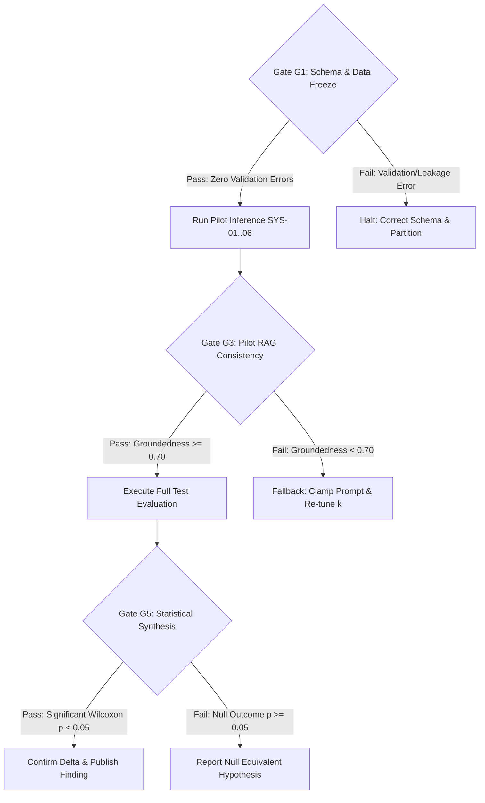

# Protocol v1: Incident Analysis RAG Reliability Evaluation

**Study Lead:** Dileep (Lead Systems / ML)  
**Status:** FROZEN  
**Date:** October 17, 2026  
**Document ID:** DIL-01-PROT-V1  

---

## 1. Research Question & Core Hypotheses

> **Core Research Question:**  
> *"Does swapping a traditional-ML detector for a higher-capacity DL ensemble, in an otherwise identical RAG incident-analysis pipeline, change the reliability of the LLM-generated incident report?"*

### Controlled Variable Strategy
To preserve strict experimental validity, this study enforces **exactly one manipulated variable**:
- **Independent Variable:** The detector subsystem producing the alert payload (Traditional ML vs. Deep Learning Ensemble).
- **Control Invariants:** Flow metadata, retrieval engine, knowledge base corpus, retrieval budget ($k$), LLM model version, prompt template, decoding temperature ($0.0$), and random seed ($42$).

---

## 2. Experimental Constants Table

| Constant | Value | Description / Scope | Owner Confirmation |
| :--- | :--- | :--- | :--- |
| **LLM Model** | Gemini 1.5 Pro / GPT-4o (`fixed version`) | Generator LLM producing incident report | `TODO-Sneha` |
| **LLM Temperature** | `0.0` | Deterministic decoding mode | Confirmed (Dileep) |
| **Top-$k$ Retrieval** | `5` | Retrieved chunks from vector KB | Confirmed (Dileep) |
| **Top-$N$ SHAP Features**| `10` | Features passed into incident prompt | Confirmed (Dileep) |
| **Random Seed** | `42` | Global pseudo-random generator seed | Confirmed (Dileep) |
| **Embedding Model** | `text-embedding-3-small` / equivalent | Embedding engine for knowledge base chunks | `TODO-Sneha` |
| **Vector DB** | ChromaDB (`chromadb>=0.4.22`) | Vector search database for local KB | Confirmed (Dileep) |
| **External Search** | Tavily Search API | Live verification cache / web lookup | `TODO-Sneha` |
| **Feature Extraction** | 10 generic flow-derived features | Standardized tabular representation | `TODO-Koushik` |

---

## 3. Detector Architecture Definitions

```
                     ┌──────────────────────────────────────────────┐
                     │            Raw Network Flow (PCAP)           │
                     └──────────────────────┬───────────────────────┘
                                            │
                                  [ Feature Extractor ]
                                            │
                    ┌───────────────────────┴───────────────────────┐
                    ▼                                               ▼
         [ Traditional ML Family ]                       [ DL Ensemble Family ]
      ┌─────────────────────────────┐               ┌─────────────────────────────┐
      │  - Random Forest (100 trees)│               │  - 1D-CNN (Temporal Conv)   │
      │  - XGBoost (Grad Boosted)   │               │  - LSTM (Bi-directional)    │
      │  - Explainer: TreeExplainer │               │  - Transformer Encoder      │
      └─────────────┬───────────────┘               │  - Explainer: GradExplainer │
                    │                               └──────────────┬──────────────┘
                    ▼                                              ▼
         [ Majority Consensus ]                         [ Majority Consensus (2/3) ]
                    │                                              │
                    └───────────────────────┬──────────────────────┘
                                            ▼
                              [ Schema v1 JSON Alert Payload ]
```

### 3.1 Detector 1: Traditional ML (`traditional_ml`)
- **Base Learners:**
  - Random Forest (`n_estimators=100`, `max_depth=12`)
  - XGBoost (`n_estimators=100`, `learning_rate=0.1`)
- **Consensus Rule:** Equal-weighted probability average across learners.
- **SHAP Tooling:** `shap.TreeExplainer` computed for the consensus class.

### 3.2 Detector 2: Deep Learning Ensemble (`dl_ensemble`)
- **Base Learners:**
  - 1D-CNN: Multi-channel 1D convolutions over normalized sequence slices.
  - Bi-LSTM: 2-layer bidirectional LSTM capturing long-term packet dynamics.
  - Transformer Encoder: 4-layer multi-head self-attention module.
- **Consensus Rule:** Hard-voting majority (2-out-of-3) for predicted label; mean confidence of majority learners.
- **SHAP Tooling:** `shap.GradientExplainer` (or `shap.DeepExplainer`).

---

## 4. Systems Table (SYS-01 through SYS-06)

| System ID | Detector Subsystem | Knowledge Sources | Retrieval Mechanism | Output Artifact |
| :--- | :--- | :--- | :--- | :--- |
| **SYS-01** | Traditional ML | Alert Payload only (No RAG) | None (Baseline 0-shot) | Baseline LLM Report |
| **SYS-02** | DL Ensemble | Alert Payload only (No RAG) | None (Baseline 0-shot) | Baseline LLM Report |
| **SYS-03** | Traditional ML | Local KB (ChromaDB) | Dense Vector Search ($k=5$) | Standard RAG Report |
| **SYS-04** | DL Ensemble | Local KB (ChromaDB) | Dense Vector Search ($k=5$) | Standard RAG Report |
| **SYS-05** | Traditional ML | Local KB + Web (Tavily Cache) | Hybrid RAG ($k=5$) | Augmented RAG Report |
| **SYS-06** | DL Ensemble | Local KB + Web (Tavily Cache) | Hybrid RAG ($k=5$) | Augmented RAG Report |

---

## 5. Pilot Set Specification

- **Sample Size:** Exactly 20 alerts (10 pairs across traditional ML vs DL ensemble).
- **1:1 Flow Mapping:** Every traditional alert pair `(ALT-xxxx, ALT-yyyy)` shares the identical network `flow_id`.
- **Stratification:** Minimum 5 distinct IoT attack classes represented (e.g., `DDoS_SYN_Flood`, `Mirai_UDP_Flooding`, `Port_Scan`, `Brute_Force_SSH`, `Benign_Anomaly`).
- **Data Partition Integrity:**
  - $0\%$ train/test overlap (`in_train_leakage_flag: false`).
  - Strict disjoint IP subnets and temporal partitioning between training corpus and pilot flows.

---

## 6. Evaluation Metrics & Grounding Rubric

Reports are evaluated against `eval/rubric_v0.md` along four primary dimensions:
1. **Groundedness ($0.0 - 1.0$):** Degree to which claims in the incident report can be mapped to provided context (retrieved chunks + SHAP attributions).
2. **Faithfulness ($0.0 - 1.0$):** Truthfulness of the report with respect to detector predictions and features (absence of contradictory deductions).
3. **Fabrication Rate ($0.0 - 1.0$):** Proportion of ungrounded technical claims (CVEs, attacker IPs, payload signatures not present in input data).
4. **Hallucination Severity (Categorical: None, Minor, Severe):** Impact of fabricated assertions on incident response actionability.

---

## 7. Decision Gates & Fallback Rules



- **Gate G1 (End of Day 1):** Strict Schema freeze. Zero schema validation errors on pilot set; zero training leakage flags.
- **Gate G3 (End of Day 3):** Pilot RAG pipeline operational across SYS-01 through SYS-06. If Groundedness $< 0.70$, prompt template must be tightened to penalize speculative reasoning.
- **Gate G5 (End of Day 5):** Final comparative statistical test (Wilcoxon signed-rank test for paired flows).

---

## 8. SHAP Hard-Voting Ensemble Resolution Rule

When resolving feature attributions for an ensemble using majority hard voting (e.g., 2-out-of-3 split):
1. **Consensus Majority Filtering:** Isolate the base learners whose vote matches the final consensus `predicted_label`.
2. **Signed Attribution Aggregation:**
   $$\Phi_i = \frac{1}{|M|} \sum_{m \in M} \phi_i^{(m)}$$
   where $M$ is the subset of learners supporting the majority class, and $\phi_i^{(m)}$ is the signed SHAP value of feature $i$ under learner $m$.
3. **Ranking & Slicing:**
   - Sort features in descending order of absolute magnitude $|\Phi_i|$.
   - Retain the top 10 ranked features.
4. **Architectural Trade-Offs:**
   - *Advantage:* Prevents minority dissident learners from contaminating the explanation of the winning decision.
   - *Limitation:* Disregards uncertainty expressed by dissenting models, which is preserved in `prediction.base_learner_votes`.

---

## 9. Out of Scope & Change Control

### Out of Scope for 5-Day Sprint
- End-to-end retraining of deep learning architectures with novel hyperparameter sweeps.
- Multi-turn interactive SOC analyst conversations.
- Dynamic autonomous agent tool-calling loops outside controlled retrieval.

### Change Control Policy
Any modification to `schema/alert_schema_v1.json` or `protocol/protocol_v1.md` requires consensus between Lead (Dileep), Detector Lead (Koushik), and RAG Lead (Sneha) with an incremental version tag (`v2`, `v3`).
